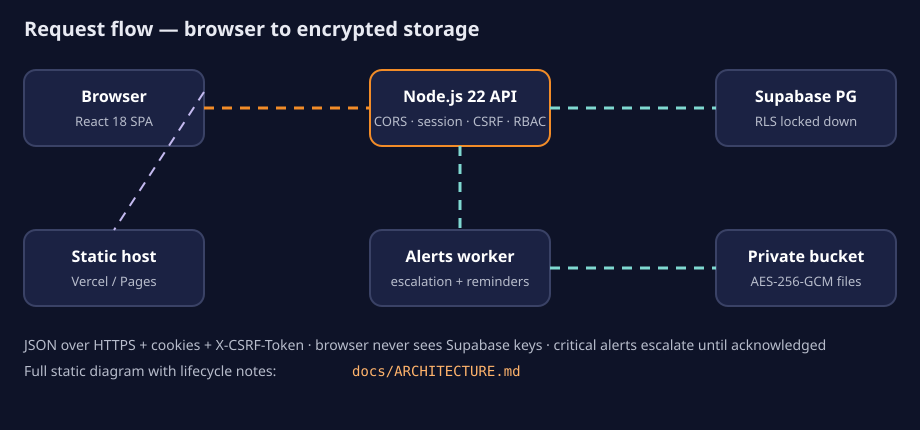

# DiagnoCare

Clinic website and secure patient and staff portal for Meghnad Diagnostic Centre (MDC), Pune. The centre has four branches: Bhosari, Moshi, Pimple Gurav and Moi.

A patient books a scan online, answers a pre-scan safety checklist and later downloads an encrypted report. When a doctor flags a report as critical, the system keeps notifying the patient and escalates to reception until someone acknowledges it. Reception works from an alert board, doctors from a priority reading queue, referring doctors track their patients, and admins manage the catalogue and site content.

The project was built as a web technology course project (CS3111). The same API exists twice: a Node.js version that is deployed, and a PHP version that is kept as the reference for the syllabus and for parity testing. See [docs/SYLLABUS_MAPPING.md](docs/SYLLABUS_MAPPING.md) for the mapping from syllabus topics to files.



## What is in the repository

| Folder | Contents |
|---|---|
| `frontend/` | React 18 and TypeScript single page app (public site and portal) |
| `api/` | Production REST API: Node.js 22, Express 5, `pg`, 101 routes in 22 modules |
| `backend/` | Reference REST API in plain PHP 8.3 (own router, middleware pipeline and container). Same routes, responses and database. Not deployed |
| `services/alerts/` | Node.js worker: critical alert escalation, appointment reminders, status page, rotating audit log |
| `database/` | 21 SQL migrations (numbered 001 to 022, 016 is unused) and seed files |
| `postman/` | Postman collection and environment (174 requests, 386 assertions) |
| `tests/flow/` | End-to-end script that runs the whole patient journey against a running API |
| `docs/` | Architecture, API, security, deployment, conventions, syllabus mapping, test report |
| `render.yaml`, `docker-compose.yml` | Render blueprint and local containers |

## Features by role

| Role | What they can do |
|---|---|
| Visitor | Browse services with modality filters, the doctor profile, branches with maps, FAQ, contact details, privacy and terms |
| Patient | Register and verify email, book, reschedule and cancel (slot capacity is row-locked, and a full branch suggests another), answer the safety checklist, add the visit to a calendar (.ics file or Google Calendar link), download reports, acknowledge critical alerts, review a completed visit |
| Receptionist | Appointment list and status changes, walk-in booking, report upload, referral linking, red-flag alert board, phone-contact notes |
| Doctor | Priority reading queue (Routine, Priority, Urgent, with waiting time), report and note upload, flag a report as critical |
| Referrer | Create referrals, follow their status, download the reports of their own patients, acknowledge critical alerts |
| Admin | Users, branches, scan categories and types, checklist items, slots, site settings, FAQs, doctor profile and photo, review moderation, audit log, statistics |

## Technology

- Frontend: React 18, TypeScript, Vite, Redux Toolkit, React Router 6, Vitest and Testing Library
- API: Node.js 22, Express 5 as the HTTP server, with the router, middleware pipeline, session store, CSRF check, validator and dependency container written in `api/src`. Argon2id for passwords, `busboy` for uploads, nodemailer for email
- Worker: Node.js, Express 5, `pg`, nodemailer
- Data: Supabase PostgreSQL (row level security on, no public grants) and a private Storage bucket for report files
- Hosting: Vercel (frontend), Render with Docker (API and worker), GitHub Actions (CI and the scheduled alert job)

## Run it locally

Requirements: Node.js 22 or newer, and a PostgreSQL database (a Supabase project, or the Postgres container in `docker-compose.yml` started with `--profile localdb`). PHP 8.3 and Composer are needed only for the migration and seed scripts and for the PHP reference API.

```bash
cp .env.example .env            # fill in the database settings and the secrets below
npm run setup                   # installs root, api, frontend and alerts dependencies
npm run setup:php               # composer install, needed by migrate and seed
npm run migrate                 # applies database/migrations in order
npm run seed                    # base data: branches, 56 scans, checklists, FAQs, settings
npm run dev                     # API :8000, app :5173, alerts :4000
```

Open `http://localhost:5173`. The Vite dev server proxies `/api` to the API, so cookies stay same-origin.

Generate `ENCRYPTION_KEY` and `CSRF_SECRET` (two different values; `APP_KEY` is also listed in `.env.example` and is used by the PHP version) with:

```bash
node -e "console.log('base64:' + require('crypto').randomBytes(32).toString('base64'))"
```

For `ALERTS_SERVICE_TOKEN` use `node -e "console.log(require('crypto').randomBytes(32).toString('hex'))"`.

The migration and seed commands (`migrate`, `migrate:status`, `seed`, `seed:dev`, `seed:demo`, `seed:purge-demo`, `db:counts`, `storage:setup`) are implemented by the PHP scripts in `backend/bin/`. The Node API has no migration runner of its own; both APIs use the same schema.

### Development accounts

`npm run seed:dev` creates one account per role (`admin@`, `doctor@`, `reception@`, `patient@` and `referrer@diagnocare.test`) and 30 days of appointment slots. All five share the password you put in `DEV_SEED_PASSWORD` in `.env` (at least 10 characters). The script stops if `DEV_SEED_PASSWORD` is empty or if `APP_ENV=production`. `npm run seed:demo` adds four reviews labelled "Demo data" and `npm run seed:purge-demo` removes them.

### Email in development

With `MAIL_DRIVER=log` (the default) verification and reset links are written to `api/storage/logs/mail.log`. Set `MAIL_DRIVER=smtp` and the `SMTP_*` variables to send real mail.

### Running the PHP reference API

```bash
npm run dev:api:php             # php -S localhost:8000 -t backend/public
npm run test:api:php            # PHPUnit
```

Stop the Node API first, since both use port 8000. The PHP API keeps sessions in files and the Node API keeps them in the `http_sessions` table, so a session cookie from one is not valid on the other.

## Tests

| Suite | Command | Result at handover |
|---|---|---|
| Node API (`node:test`) | `npm run test:api` | 330 tests in 54 suites, all passing, no database needed |
| Frontend (Vitest) | `npm run test:web` | 161 tests in 16 files, all passing |
| Alerts worker | `npm run test:alerts` | 17 tests, all passing |
| PHP reference (PHPUnit) | `npm run test:api:php` | 441 tests, 1008 assertions, no failures |
| Postman collection | newman, see the test report | 174 requests, 386 assertions, 0 failed against both APIs |
| Full journey | `node tests/flow/full-journey.mjs` | 15 of 15 steps (needs `DEV_SEED_PASSWORD`) |

`npm test` runs the Node API, frontend and worker suites. `npm run build` type-checks and builds the frontend. [docs/TEST_REPORT.md](docs/TEST_REPORT.md) lists the cases and results, including the 45-case hostile input check and the Node and PHP comparison.

## Deployment

The live setup is the frontend on Vercel at `meghnaddiagnostics.me` with a rewrite of `/api/*` to the Node API on Render, and the database and report bucket on Supabase. [docs/DEPLOYMENT.md](docs/DEPLOYMENT.md) has the steps, the environment variables and the keep-alive schedule.

`render.yaml` builds the API from `api/Dockerfile` (Node 22) and the worker from `services/alerts/Dockerfile`. Secrets are marked `sync: false` and are entered in the Render dashboard.

To create the first admin account on a fresh database, generate an Argon2id hash with the Node API's own dependency and insert the user in the Supabase SQL editor:

```bash
node -e "require('./api/node_modules/argon2').hash('CHOOSE-A-STRONG-PASSWORD',{type:2}).then(console.log)"
```

```sql
INSERT INTO users (email, password_hash, role, full_name, email_verified_at, password_changed_at)
VALUES ('admin@your-domain.example', '<hash>', 'admin', 'Clinic Admin', now(), now());
```

Sign in, change the password and create the other staff accounts from the admin panel. Do not run `seed:dev` or `seed:demo` on a production database.

## Encryption keys

Report files, report notes, impressions and referral notes are encrypted with AES-256-GCM (`api/src/services/encryption.js`, and `backend/src/Services/EncryptionService.php` in the PHP version) with a new 12 byte IV for every value. Text values are stored as `dc:v<version>:<iv>:<tag>:<ciphertext>`. `STORAGE_DRIVER=supabase` writes the encrypted bytes to the private bucket and `local` writes them to `api/storage/reports`.

To rotate the key, generate a new `ENCRYPTION_KEY`, move the old one into `ENCRYPTION_KEYS_PREVIOUS` as `1=base64:OLD`, raise `ENCRYPTION_KEY_VERSION`, then run `php backend/bin/rotate-encryption.php` to preview and `--apply` to re-encrypt. Remove the old key once nothing refers to it. If an encryption key is lost, the data encrypted with it cannot be recovered. Keep keys in the host's secret store and never in git.

## Scope and known limits

- There are no online payments. Fees are not published.
- SMS is a stub that records an `sms_stub` event. Email is the working notification channel, and it writes to a log file until SMTP credentials are set.
- The in-app critical alert banner is polled every 60 seconds. There is no push channel.
- In production the escalation and reminder jobs run from GitHub Actions every 30 minutes, so an escalation step can be up to 30 minutes later than its due time. The always-on worker in `render.yaml` checks every 60 seconds if it is kept running.
- The Render free plan puts the API to sleep after 15 idle minutes. The GitHub workflow pings it to keep it awake, and a cold start can take up to a minute.
- The Privacy and Terms pages were written by the team and have not been reviewed by a lawyer.
- The WhatsApp number and contact email are not shown on the site because the centre has not supplied them.
- Schema changes are applied with the PHP runner (`npm run migrate`).

## Documentation

| File | Contents |
|---|---|
| [docs/ARCHITECTURE.md](docs/ARCHITECTURE.md) | System diagram, request lifecycle, data model, alert flow |
| [docs/API.md](docs/API.md) | Every endpoint with roles and the reason for each HTTP method |
| [docs/SECURITY.md](docs/SECURITY.md) | Each control and the file that implements it |
| [docs/DEPLOYMENT.md](docs/DEPLOYMENT.md) | Render, Vercel, Supabase and GitHub Actions setup |
| [docs/SYLLABUS_MAPPING.md](docs/SYLLABUS_MAPPING.md) | Syllabus and instructor checklist items mapped to files |
| [docs/CONVENTIONS.md](docs/CONVENTIONS.md) | Code layout, schema notes, how to add an endpoint, page or migration |
| [docs/TEST_REPORT.md](docs/TEST_REPORT.md) | Test cases with results |
| [DECISIONS.md](DECISIONS.md) | Design decisions and the reasons for them |
| [PROGRESS.md](PROGRESS.md) | What was built and how it was verified |
| [MANUAL_STEPS.md](MANUAL_STEPS.md) | Items that need the centre or the hosting accounts |
| [CREDITS.md](CREDITS.md) | Credits |
