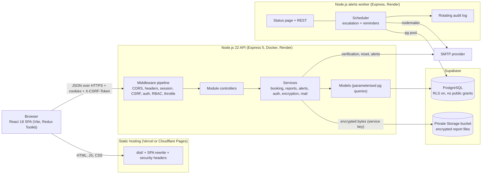
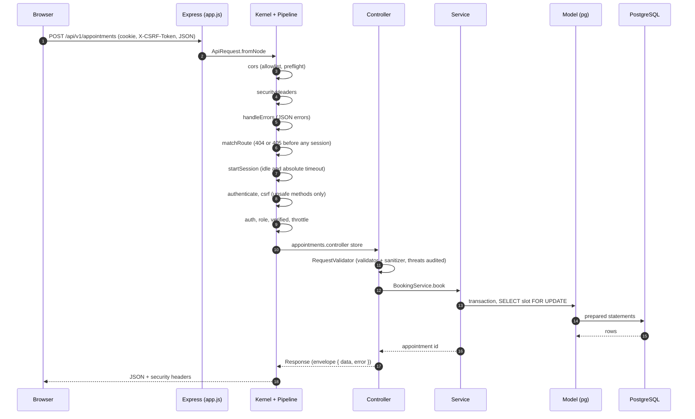
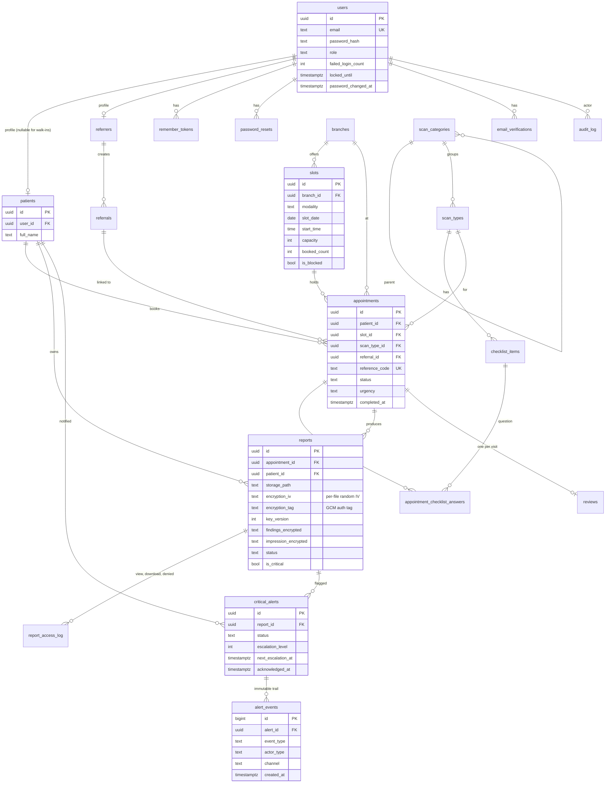
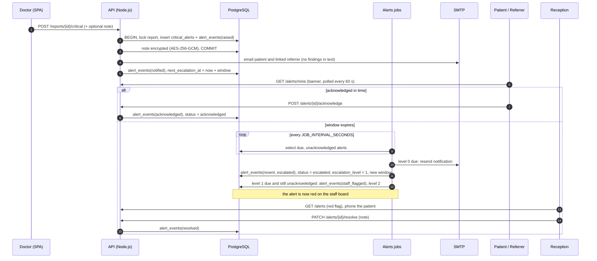

# Architecture

DiagnoCare has three runtime parts and one database: a React single page app, a Node.js REST API, a Node.js worker for time-based jobs, and Supabase (PostgreSQL plus private object storage). A second implementation of the REST API in plain PHP lives in `backend/`. It serves the same routes against the same schema, is used for the syllabus Unit I material and for side-by-side testing, and is not deployed.

## System overview

Key points:

- The browser only ever talks to the static host and the API. It never receives Supabase keys.
- Only the API and the worker connect to the database, with the `diagnocare_app` role. Row level security with no policies blocks every other path.
- Report files are encrypted by the API (AES-256-GCM) before they reach Storage.
- The API creates a critical alert and sets `next_escalation_at`. The worker's jobs find due alerts and escalate them. Both read `ALERT_ESCALATION_MINUTES`.
- In production the worker's jobs are run once every 30 minutes by a GitHub Actions workflow (`npm run jobs:once`). The same code runs as a long-lived service with a 60 second timer when `diagnocare-alerts` is kept running.

## Layers in the API

Express 5 is only the HTTP server in `api/src/app.js`. It reads the raw body and hands each request to the application's own kernel, so routing, middleware, sessions, CSRF and validation are visible code in `api/src`.

| Layer | Directory | Role |
|---|---|---|
| Entry | `api/src/server.js`, `app.js` | Loads the environment, builds the app, listens, shuts down cleanly |
| Container | `api/src/container.js` | Creates models, services, mailer, limiter and validator once and passes them to modules (dependency injection by construction) |
| Core | `api/src/core` | Router, kernel, middleware pipeline, request and response objects, session, cookies, CSRF, error classes and handler, config, database |
| Middleware | `api/src/middleware` | CORS, security headers, error handling, route matching, session start, authentication, CSRF, then per-route `auth`, `role`, `verified`, `throttle` |
| Modules | `api/src/modules/<name>` | 22 modules. Each has `index.js` listing its routes and a controller that parses input, calls services and returns a response |
| Services | `api/src/services` | Business rules: booking transaction, report storage, alert workflow, auth, encryption, mail |
| Models | `api/src/models` | One class per table family. All SQL lives here |
| Validation | `api/src/validation` | `validator.js`, `sanitizer.js`, `request-validator.js` |

`api/src/routes.js` lists the modules and builds the full route table under `/api/v1`: 101 routes.

The PHP version has the same layers: `backend/public/index.php` (front controller), `backend/src/Core`, `Middleware`, `Controllers`, `Services`, `Models`, `Validation`, with the container wired in `backend/config/container.php` and the routes in `backend/routes/api.php`.

## Request lifecycle

Every response uses one envelope: `{ "data": ..., "error": null }` on success and `{ "data": null, "error": { "code", "message", "fields?" } }` on failure.

## Data model

Main tables (columns trimmed to keys and the fields that matter for the design). All entity ids are UUIDs; `alert_events`, `audit_log` and `report_access_log` are append-only logs.

Rules enforced in the schema (`database/migrations/`):

- One non-cancelled appointment per patient per slot (partial unique index in `005_scheduling.sql`).
- `slots.booked_count <= capacity` check; capacity is also guarded in code by row locks.
- `alert_events` cannot be updated, deleted or truncated (triggers in `007_alerts.sql`).
- Every table has Row Level Security enabled and no policies; `anon` and `authenticated` have no grants (`010_lock_down_public_roles.sql`).
- One review per appointment (`reviews.appointment_id` unique).
- Other tables not drawn: `branches`, `faqs`, `site_settings`, `login_attempts`, `rate_limits`, `audit_log`, `http_sessions` (Node API sessions) and `schema_migrations`. In total there are 25 application tables plus `schema_migrations`.

## Critical alert flow

Every state change is a row in `alert_events`, so the full timeline can be shown to staff via `GET /alerts/{id}/events`. SMS is a stub (`api/src/services/alerts/alert-service.js`, `services/alerts/src/channels/smsChannel.js`) that records an `sms_stub` event.

## Frontend structure

- Routing: `frontend/src/App.tsx` (lazy pages, public, auth, portal and admin trees).
- State: one Redux Toolkit store (`app/store.ts`) with `auth`, `booking`, `alerts` and `public` slices; local component state for UI-only concerns; Context only for the theme.
- API layer: `api/client.ts` adds the CSRF token, parses the envelope and throws `ApiError`; `hooks/useApi.ts` exposes loading and error state.
- Guards: `ProtectedRoute` and `GuestRoute` choose the destination from `lib/roles.ts`.

## Deployment topology

| Part | Host | Config |
|---|---|---|
| SPA | Vercel (or Cloudflare Pages) | `frontend/vercel.json`, `frontend/public/_redirects`, `frontend/public/_headers` |
| API | Render web service (Docker, Node 22) | `api/Dockerfile`, `render.yaml` |
| Alert jobs | GitHub Actions every 30 minutes; optional Render service | `.github/workflows/keepalive-and-jobs.yml`, `services/alerts/Dockerfile`, `render.yaml` |
| Database and bucket | Supabase | `database/migrations`, `backend/bin/storage-setup.php` |

The Vercel project rewrites `/api/*` to the Render API, so the browser sees one origin and the session cookie is first-party (`SameSite=Lax; Secure`). If the SPA and API were on different sites, the cookie would need `SameSite=None; Secure` and `CORS_ALLOWED_ORIGINS` would have to list the SPA origin. See `docs/DEPLOYMENT.md`.
